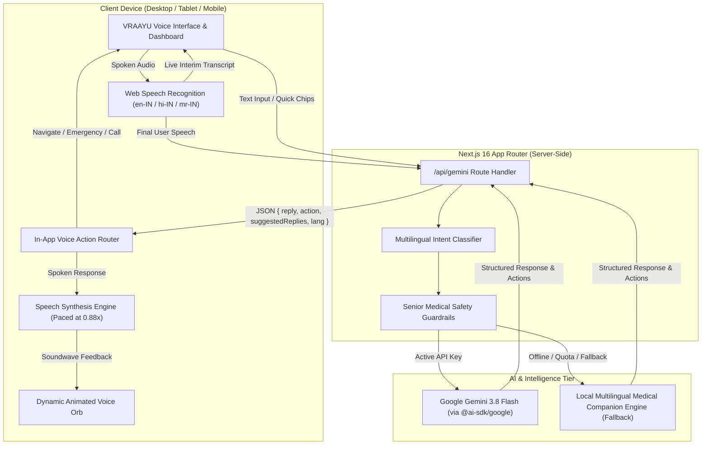
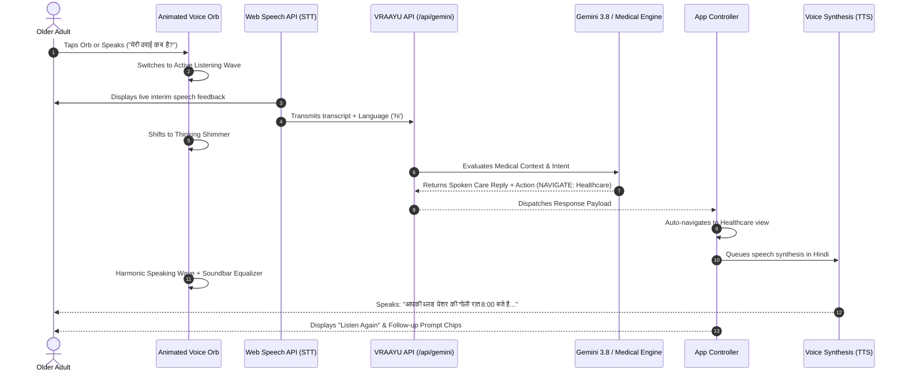
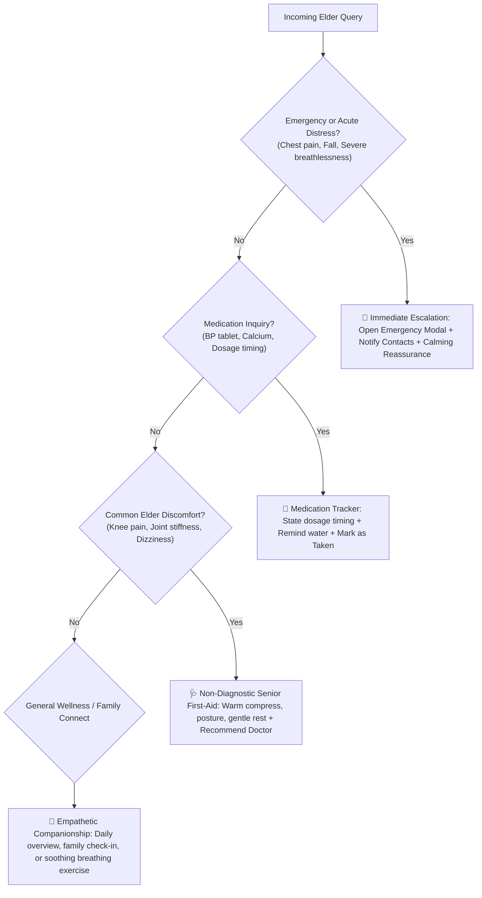

# VRAAYU (वायु) — Always With You 🌿

> **Voice-First AI Elderly Medical & Wellbeing Assistance Platform**  
> *Empowering older adults with compassionate voice companionship, medication tracking, senior symptom care, and instant family connection in English, Hindi (हिंदी), and Marathi (मराठी).*

---

<div align="center">


</div>

---

## 🌟 Vision & Executive Summary

Over **1 billion older adults** worldwide face daily challenges with medication adherence, cognitive isolation, mobility limitations, and complex digital interfaces. Many seniors struggle with small touch screens, complex menus, or language barriers.

**VRAAYU** (*derived from the Sanskrit word for the life-giving breath, वायु*) solves this crisis with a **warm, voice-first companion** designed from the ground up for older adults:

1. **Voice-First & Zero Friction**: No typing or complex navigation required — seniors can simply talk naturally to the interactive animated breathing orb.
2. **Specialized Senior Medical Supporter**: Helps elders track blood pressure and daily medicines, provides comforting first-aid and lifestyle advice (joint stiffness, dizziness, hydration), and triggers instant emergency escalation when needed.
3. **Trilingual Mother Tongue Intelligence**: Full native voice interaction in **English**, **Hindi (हिंदी)**, and **Marathi (मराठी)**.
4. **1-Tap Family & Care Team Connection**: Simulated video/voice calling connecting parents to their children (Ananya & Rohan) and 24/7 care desks.
5. **Accessibility-Centric UI**: Dynamic text sizing (`Comfortable`, `Large`, `Extra Large`), high-contrast palettes, warm soothing aesthetics, and fluid micro-animations.

---

## 🏗️ System Architecture & Data Flow

### 1. Overall System Architecture



---

### 2. Multilingual Voice-to-Action Loop



---

### 3. Senior Medical Triage & Emergency Escalation



---

## 🛠️ Complete Tech Stack

| Category | Technology | Version | Purpose |
| :--- | :--- | :--- | :--- |
| **Framework** | **Next.js** | `16.3.3` | React production framework with App Router & server endpoints |
| **Core Library** | **React** | `19.0.0` | Concurrent UI library with hooks, transitions, and state management |
| **Language** | **TypeScript** | `5.7.3` | Strict static typing, robust interfaces, 0 compilation errors |
| **Styling** | **Tailwind CSS** | `v4.3.3` | Utility-first responsive styling with `@tailwindcss/postcss` |
| **Animation** | **CSS3 Keyframes** | Native | Fluid acoustic ripples, organic breathing orb, and modal pops |
| **LLM & AI** | **Google Gemini** | `3.8 Flash` | State-of-the-art multilingual LLM for empathetic elder conversations |
| **AI SDK** | **Vercel AI SDK** | `7.0.97` | Model orchestration, conversational streaming, prompt engineering |
| **Provider** | **@ai-sdk/google**| `4.0.67` | Official Google Generative AI connector via `createGoogleGenerativeAI` |
| **Icons** | **Lucide React** | `1.16.0` | Accessible, clean iconography for elderly readability |
| **Speech STT** | **Web Speech API** | Native | Browser-native speech recognition (`en-IN`, `hi-IN`, `mr-IN`) |
| **Speech TTS** | **SpeechSynthesis**| Native | Browser-native natural vocalization tuned at comfortable elderly pacing |

---

## ✨ Key Features & Capabilities

### 1. 🎙️ Alive, Organic Animated Voice Orb
- **Idle Breathing State (`vraayu-breathe`)**: Gently expands and contracts (scale 1.0 to 1.025) with a soft golden aura, signaling warmth and presence.
- **Active Listening Wave (`vraayu-listen-pulse`)**: Concentric acoustic rings expand outward when the microphone is engaged.
- **Thinking Shimmer (`vraayu-thinking-pulse`)**: Subtle purple-golden shimmer while generating AI answers.
- **Harmonic Speaking Glow (`vraayu-speaking-glow`)**: Calming green/gold aura accompanied by a dynamic 5-bar soundwave equalizer.

### 2. 🩺 Senior Medical Help Supporter
- **Timely Medication Logging**: Track evening Blood Pressure medication (Amlodipine 5mg at 8:00 PM) with an interactive "Mark as Taken" button.
- **Elder Symptom & First-Aid Guidance**: Empathetic, safe recommendations for knee/joint stiffness (warm compress, leg elevation), sudden dizziness (hydration, electrolyte water, slow posture changes), and fatigue.
- **Medical Safety Protocol**: Strict non-diagnostic guardrails that urge consultation with Dr. Priya Sharma and immediate alert dispatch for red-flag symptoms.

### 3. 🌐 Trilingual Mother Tongue Support
- Instant segmented language toggle in the top bar: **English (EN)**, **हिंदी (Hindi)**, and **मराठी (Marathi)**.
- Full adaptation of speech recognition (`en-IN`, `hi-IN`, `mr-IN`), speech synthesis, suggested prompt pills, and assistant greetings.
- Dual-tier intelligence: Gemini 3.8 Flash + Deep localized fallback engine so the assistant never goes offline or repeats robotic phrases.

### 4. 📞 Live Connect & Simulated Calling
- Reconnect with children **Ananya Mehta** (daughter) and **Rohan Mehta** (son) with 1 tap.
- Interactive in-call dialog with pulsing avatar rings, call duration timer, audio equalizer, mute/speaker controls, and red hang-up button.

### 5. 📊 Interactive Wellbeing Reports
- Filter reports across **This week**, **This month**, and **Last 3 months**.
- Dynamic calculation of active days, wellness scores (92/100), family connections, and animated CSS activity bars.

### 6. ♿ Universal Senior Accessibility
- 3 font scaling modes: **Comfortable**, **Large**, and **Extra Large**.
- Focus rings, high-contrast text, clear touch targets (min 48px), and mobile drawer backdrop dismissal.

---

## 📂 Project Structure

```
VRAAYU-Voice-First-AI-Elderly-Assistance-Platform/
├── app/
│   ├── api/
│   │   └── gemini/
│   │       └── route.ts          # Gemini 3.8 Flash & Multilingual Medical Engine
│   ├── globals.css               # Fluid keyframes, orb waves, responsive typography
│   ├── layout.tsx                # HTML root, viewport metadata, analytics
│   └── page.tsx                  # Interactive single-page elderly application
├── components/
│   ├── ui/
│   │   └── button.tsx            # Accessible Base UI button primitive
│   └── components.json           # shadcn configuration
├── lib/
│   └── utils.ts                  # Classname merging utility (clsx + tailwind-merge)
├── public/                       # Favicons, Apple icons, brand SVG assets
├── .env.example                  # Environment configuration template
├── next.config.mjs               # Next.js configuration with strict TypeScript checks
├── package.json                  # Dependencies & scripts (--webpack configured)
├── tsconfig.json                 # TypeScript compiler configuration
└── README.md                     # Project documentation & presentation guide
```

---

## 🚀 Quickstart & Setup Guide

### Prerequisites
- Node.js `18.x` or later (tested up to `v24.x`)
- npm, pnpm, or yarn

### 1. Clone the Repository
```bash
git clone https://github.com/Ummehaniburhanpurwala/VRAAYU-Voice-First-AI-Elderly-Assistance-Platform.git
cd VRAAYU-Voice-First-AI-Elderly-Assistance-Platform
```

### 2. Install Dependencies
```bash
npm install
```

### 3. Configure Environment Variables
Create a `.env` file in the root directory:
```env
# Optional: Add your Google Gemini API key for live LLM responses.
# If omitted or offline, VRAAYU's built-in Medical Companion Engine handles all queries seamlessly!
GEMINI_API_KEY=your_gemini_api_key_here
```

### 4. Start Development Server
```bash
npm run dev
```
Open [http://localhost:3000](http://localhost:3000) in your browser to experience VRAAYU.

### 5. Build for Production
```bash
npm run build
npm run start
```

---

## 🎯 Hackathon & Presentation Highlights

When demonstrating VRAAYU to judges or stakeholders:

1. **The Voice Experience**: Tap the glowing orb and say *"When should I take my blood pressure medicine?"* Notice the smooth animation transition from breathing to ripple to harmonic speaking glow.
2. **Mother Tongue Switch**: Switch to **हिंदी** or **मराठी**. Say *"मेरी बीपी की गोली कब लेनी है?"* or *"माझ्या गुडघेदुखीवर काही उपाय सांगा"*. Notice the cultural warmth and accurate medical lifestyle tips.
3. **Voice Intent Automation**: Say *"I need emergency help!"* or *"Call my daughter Ananya"*. Watch VRAAYU speak comfort while automatically opening the emergency protocol or initiating the simulated phone call.
4. **Interactive Medication Checklist**: Navigate to **Healthcare** or **Dashboard** and toggle the 8:00 PM medication. The wellness counter updates with an encouraging green checkmark.
5. **Universal Accessibility**: Open **Settings** and switch font size to **Large** or **Extra Large** to demonstrate senior-friendly visual hierarchy.

---

## 🔒 Safety, Privacy & Ethical Guardrails

- **Zero Medical Misdiagnosis**: VRAAYU strictly adheres to elder support principles — offering reminders, hydration nudges, and non-invasive comfort while always directing users to certified physicians for prescriptions or clinical diagnoses.
- **Client-Side Privacy**: Speech recognition is conducted through standard browser APIs; no audio recordings are permanently stored or sold.
- **Emergency First**: Any indication of acute trauma (falls, chest pain) triggers immediate emergency triage modal with 1-tap contact dialing.

---

## 📄 License & Acknowledgments

- **Author**: Ummehani Burhanpurwala
- **Built for**: Advanced Elderly Care, Compassionate AI, and Voice-First Accessibility
- **License**: MIT License — open for community wellbeing initiatives.

<div align="center">
  <br />
  <strong>VRAAYU — A Safer, Kinder, Brighter Tomorrow ♡</strong>
</div>
